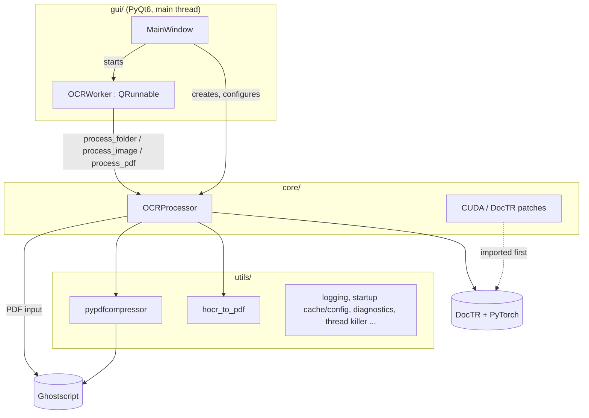
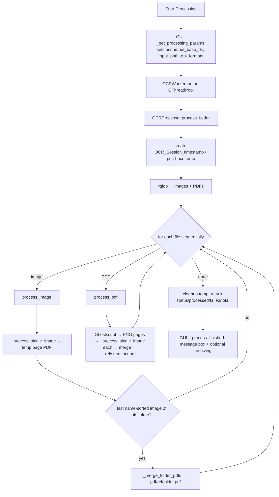

# Architecture

VisionLane OCR is a Windows-oriented desktop application (PyQt6) that batch-converts scanned images and PDFs into
**searchable PDFs** and/or **hOCR** files using [DocTR](https://github.com/mindee/doctr) (PyTorch) for text
detection + recognition.

```
repo
├── main.py                 GUI entry point (splash → progressive import → MainWindow)
├── run_ocr.py              Headless script (currently broken, see VL-001/VL-051)
├── debug_run.py            Debug wrapper (broken: calls main.main())
├── verify_models.py        Pre-downloads db_resnet50 + parseq (used by build scripts)
├── config.ini              Persisted GUI/startup settings
├── core/                   OCR engine + CUDA/DocTR compatibility patches
├── gui/                    PyQt6 window, worker thread, (unused) splash/log handler
├── utils/                  PDF/HOCR conversion, compression, logging, startup helpers
├── data/                   Unused paper-size table + generator script
├── build.spec / build_*.bat   PyInstaller and Nuitka packaging
└── docs/                   This documentation
```

## 1. Layers



`OCRProcessor` is a single large class (≈1400 lines) that owns the model, the output directories, temp files,
cancellation state and the merge logic. The GUI configures it by **assigning attributes directly**
(`ocr.dpi`, `ocr.output_formats`, `ocr.compress_enabled` …), so there is no formal API between the two.

## 2. Startup sequence (`main.py`)

```mermaid
sequenceDiagram
    participant M as main.py
    participant Q as Qt event loop
    M->>M: set USE_TORCH=1, DOCTR_BACKEND=torch
    M->>Q: show_instant_splash() (plain QWidget, white box)
    M->>Q: QTimer.singleShot(100) → load_modules_progressively
    Note over M: everything below runs ON the GUI thread
    M->>M: import core.cuda_patch_wrapper
    Note right of M: triggers core/__init__ → ocr_processor (imports torch, doctr, PyPDF2, ocrmypdf) → doctr_patch → doctr_torch_setup (replaces builtins.__import__, probes CUDA)
    M->>M: apply_hardware_monitoring_patches()
    M->>M: import utils.debug_helper, startup_cache; StartupConfig()
    M->>M: setup_logging(); SystemDiagnostics.run_diagnostics(quick=True)
    M->>M: EnhancedModelManager()  (constructed, nothing downloaded)
    M->>M: import gui.main_window (imports torch again, pynvml…)
    M->>M: launch_main_application → DebugLogger() + MainWindow()
    M->>Q: QTimer.singleShot(0, MainWindow._delayed_init)
    Note over M: _delayed_init: populate model combos (may download), OCRProcessor() (GPU check, load model), setup file logging, start 1 s hardware timer
    M->>Q: window.show(); close splash after 500 ms
```

The "progressive loading" percentages are cosmetic (artificial `sleep`s; two status updates are commented out by a
merge bug, VL-039). `ParallelLoader`, `StartupLoader` and the `startup_cache` are **not** used on this path.

Exit: `aboutToQuit → cleanup_on_exit` (terminates child processes, `sys.exit(0)`), `MainWindow.closeEvent`
(`sys.exit(0)` again) and finally `os._exit` after `app.exec()` (VL-035).

## 3. Processing pipeline

### 3.1 Folder mode (the only mode that works)



### 3.2 One image (`OCRProcessor._process_single_image`)

1. Open with Pillow; flatten alpha onto white or convert to RGB (temp PNG if converted).
2. Decide DPI: explicit GUI value → else image metadata → else 300.
3. CUDA housekeeping (sync, `empty_cache`, sets `CUDA_LAUNCH_BLOCKING=1` — VL-006).
4. `DocumentFile.from_images(path)` → `self.model(docs)` under `torch.no_grad()`; on `RuntimeError("CUDA…")` move to CPU permanently (VL-007).
5. `result.export_as_xml()` → hOCR-style XML written to a temp `.hocr`; copied to `hocr/<rel>/<stem>.hocr` when HOCR output is requested.
6. If PDF requested: `utils.hocr_to_pdf.hocr_to_pdf(hocr, image, intermediate_pdf, dpi)` (up to 3 attempts) → copy to the numbered temp page PDF.
7. Optional per-page Ghostscript "compression" (VL-014).
8. `finally`: delete temp files, `empty_cache`, `gc.collect()`.

### 3.3 Output layout

```
<output>/OCR_Session_YYYYMMDD_HHMMSS/
    pdf/<relative input folder>/<folder name>.pdf        # all images of a folder merged, name-sorted
    pdf/<relative input folder>/<pdf stem>_ocr.pdf       # for PDF inputs
    hocr/<relative input folder>/<image stem>.hocr       # per image
    hocr/<relative input folder>/<pdf stem>/<pdf stem>_page_0001.hocr   # per PDF page
    temp/                                                # removed at the end
```

For images at the root of the chosen folder, the folder's own name is used as `<relative input folder>`.

## 4. Threading and cancellation model

| Thread | What runs |
|--------|-----------|
| Main (Qt) | Everything in `main.py`, `MainWindow` (including model download, `OCRProcessor()` construction, hardware polling every 1 s, folder scanning) |
| `QThreadPool` worker | `OCRWorker.run` → whole batch, sequentially, one file at a time |
| `ImageProcessor` (daemon) | Started per worker, never given work (VL-034) |
| `MemoryMonitor` (daemon) | Logs RSS/VRAM every 10 s forever (`DebugLogger`) |

Cancellation is a set of flags (`is_cancelled`, `_force_stop`, `_exit_event`) checked **between** images, plus
`ThreadKiller`/`ProcessManager` brute force (VL-022). A model forward pass cannot be interrupted.

`OCRProcessor.thread_pool` (a `ThreadPoolExecutor` sized to the logical CPU count) and two `spawn` multiprocessing
queues are created but never used.

## 5. Compatibility / patch layer

Historically written to make DocTR+PyTorch+CUDA 12.8 work inside Nuitka/PyInstaller builds:

| Module | Purpose | Status |
|--------|---------|--------|
| `core/cuda_patch_wrapper.py` | Orchestrates the patches below, patches `torch.version.cuda` | imported by `main.py` |
| `core/cuda_env_patch.py` | Sets CUDA environment variables | applied via wrapper; contains VL-008 |
| `core/nuitka_cuda_patch.py` | Wraps `torch.cuda.*`, fake device props in fallback | applied if "Nuitka" detected; also imported by `ocr_processor` |
| `core/runtime_cuda_patch.py` | Wraps `torch.tensor/zeros/…` | **never imported** |
| `core/cuda_compat_plugin.py` | Nuitka plugin to fake CUDA 12.9 | **never activated** |
| `core/hardware_monitoring_patch.py` | Safe psutil/pynvml/wmi wrappers | applied; detection likely never true |
| `core/doctr_patch.py`, `core/doctr_torch_setup.py` | Force DocTR to see PyTorch (TF/Torch detection of doctr < 1.0) | obsolete with doctr ≥ 1.0 |

With python-doctr ≥ 1.0 (PyTorch only) and current PyTorch wheels none of these are needed — see
[modernization.md](modernization.md).
