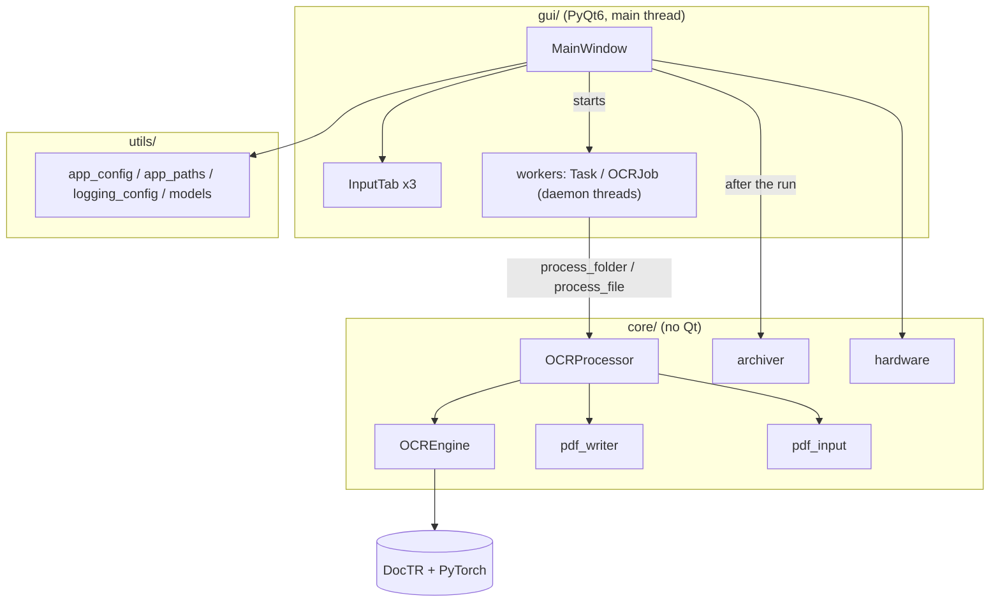
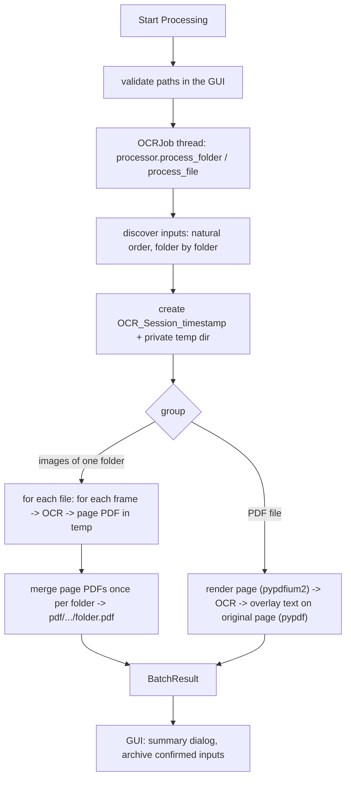

# Architecture

VisionLane OCR is a desktop application (PyQt6) that batch-converts scanned images and PDFs into **searchable PDFs**
and/or **hOCR** files using [DocTR](https://github.com/mindee/doctr) (PyTorch) for text detection + recognition.

```
repo
├── main.py              GUI entry point (splash -> background import -> MainWindow)
├── run_ocr.py           Command line interface (same OCRProcessor API)
├── verify_models.py     Pre-downloads the default models (used by the build scripts)
├── core/                OCR engine, orchestration, PDF reading/writing, archiving (no Qt)
├── gui/                 PyQt6 window, input tabs, background workers, theme, dialogs
├── utils/               config, paths, logging, model catalogue, diagnostics
├── data/                paper-size table (groundwork for the "uniform paper size" roadmap item)
├── tests/               pytest suite (headless)
└── build.spec, build_*.bat, .github/workflows/pylint.yml
```

## 1. Layers



The only interface between GUI and engine is: `OCRProcessor(...)`, `configure(...)`, `progress_callback`,
`process_folder()/process_file()`, `cancel()`, and the returned `BatchResult`. `core/` never imports Qt, so it can be
used from the CLI and tested without a display; `core.ocr_processor` does not even import torch unless it has to build
an engine (tests inject a fake engine).

## 2. Startup sequence (`main.py`)

1. Load `config.ini` (`AppConfig`), set up logging once (`utils/logging_config.setup_logging`), install crash handlers.
2. Create `QApplication`, show the splash immediately.
3. A **background thread** imports `torch` and `doctr.models` (the slow part) while the splash animates.
4. When the import finishes, create `MainWindow` and show it. `MainWindow` builds the UI from the config and starts an
   `engine-load` task on a background thread: download missing models, build `OCRProcessor` (device detection, CUDA
   smoke test, model load). The *Start* button is enabled when it is ready; failures are shown in a dialog.
5. Exit: `closeEvent` (asks if a job runs -> cancel -> wait up to 30 s -> save config) -> `app.exec()` returns.

There are no `sleep`s, no import-time patches and no second splash.

## 3. Processing pipeline



### 3.1 One image page (`OCRProcessor._ocr_page`)
1. `_open_frames`: Pillow opens the file; every frame of a multi-frame TIFF is a page; EXIF orientation applied; DPI = user value, else image metadata (30-4800), else 300.
2. The image is converted to an RGB array and passed to `OCREngine.predict()` (`torch.inference_mode()`; CUDA OOM recovery, see below).
3. The DocTR result is converted to `OcrPage` (words in pixel coordinates) for the PDF and, if requested, exported with `export_as_xml()` as HOCR.
4. `pdf_writer.write_image_page_pdf`: page size = pixels x 72 / dpi; the image is embedded (JPEG-recompressed at the chosen quality, Flate for lossless, or the original JPEG bytes if nothing changes); the text is drawn invisibly (render mode 3), each word scaled to its box.

### 3.2 PDF input (`core/pdf_input.py`)
`PdfSource` (pypdfium2) reports the page count, whether a page already has text (>= 20 characters) and renders a page at
the chosen DPI (default 300, capped at 40 megapixels). After OCR, `apply_text_layers` clones the source with pypdf and
merges one text-only overlay page per recognised page (the cropbox offset and `/Rotate` are handled). Pages that were
skipped, or failed, are copied unchanged, so the output always has every page of the input.

### 3.3 Out-of-memory handling (`core/ocr_engine.py`)
`predict` -> on CUDA OOM: `empty_cache()`, retry on the GPU -> still OOM: run **this call** on the CPU and move the model
back to the GPU. Any other CUDA error switches to the CPU for the rest of the session. At start-up a one-kernel smoke
test catches GPUs the installed PyTorch cannot run, and a notice is shown when the GPU has less than 8 GB.

### 3.4 Output layout
```
<output>/OCR_Session_YYYYMMDD_HHMMSS/
    pdf/<relative folder>/<folder name>.pdf     all images of a folder, natural name order (root folder: <input folder name>.pdf)
    pdf/<relative folder>/<name>.pdf            PDF inputs: original pages + text layer
    pdf/<name>.pdf                              single image / single PDF
    hocr/<relative folder>/<image name>.hocr    per image (multi-frame TIFF: <name>_p0002.hocr; clashes: <name>_<ext>.hocr)
    hocr/<relative folder>/<pdf name>/<pdf name>_page_0001.hocr
```
Name clashes anywhere in a session get ` (2)`, ` (3)`... The session folder is only created when there are inputs.
Intermediate page PDFs live in a private `tempfile.TemporaryDirectory` that is removed at the end of every run.

### 3.5 Results and failure policy
Every input file produces a `FileResult` with a `Status`:

| Status | When | Archived? |
|--------|------|-----------|
| `SUCCESS` | all pages processed and written | yes (if archiving is on) |
| `PARTIAL` | some pages failed; the output contains the others | no |
| `FAILED` | unreadable file, no page worked, or the merge failed | no |
| `CANCELLED` | not (completely) processed because of Cancel | no (and nothing is archived after a cancel) |

A cancelled run does not write the merged PDF of the folder that was in progress.

## 4. Threading and cancellation

| Thread | What runs |
|--------|-----------|
| Main (Qt) | UI, the 1 s hardware read-out (`HardwareMonitor`), signal handlers, archiving (fast file moves) |
| `preload` (daemon) | `import torch, doctr` during start-up |
| `engine-load` / `engine-reload` (daemon) | model download, engine construction, model/device switches |
| `ocr-job` (daemon) | the whole batch, sequentially |
| `count-files` (daemon) | counting images/PDFs in a selected folder |

All are plain `threading.Thread` daemons wrapped in `gui.workers.Task`; results come back to the GUI thread as Qt signals.
Cancellation is cooperative (`threading.Event`), checked between pages and files; a page that is already in inference
finishes first (VL-065).
